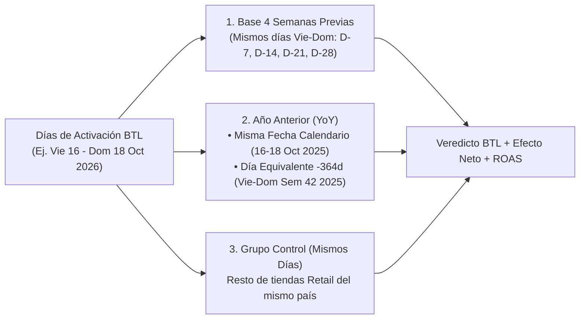

# Manual de Usuario — Dashboard de Ventas & Evaluador de Activaciones BTL (Marketing)

**SLC Trade · Samsung Mobile eXperience (NCA: Guatemala, El Salvador, Honduras)**

Este manual explica paso a paso cómo utilizar el **Dashboard de Ventas & Activaciones BTL** para registrar eventos de Marketing en tiendas (`SMS`, `SES`, `Kioscos`) y medir de forma objetiva qué tanto funcionó cada activación en ventas, unidades y retorno sobre la inversión (`ROAS`).

---

## 1. ¿Cómo abrir el Dashboard?

Existen dos formas de abrir y trabajar con la herramienta según cómo te la hayan compartido:

> [!TIP]
> **Opción A — Archivo directo (`Dashboard_BTL_Ventas.html`) desde OneDrive / Teams / Correo:**
> Haz doble clic sobre el archivo `Dashboard_BTL_Ventas.html`. Se abrirá directamente en tu navegador (Chrome o Edge) sin necesidad de instalar nada ni conectarte a ningún servidor.

> [!NOTE]
> **Opción B — Aplicación conectada (`iniciar_tablero_btl.bat`):**
> Si trabajas desde el equipo donde está sincronizada la base de ventas, haz doble clic en `iniciar_tablero_btl.bat`. Se abrirá automáticamente `http://127.0.0.1:8095` y todos los cambios que hagas se guardarán directo en el archivo Excel maestro `Activaciones_BTL.xlsx`.

---

## 2. Barra Superior de Filtros Globales

En la parte superior de la pantalla encontrarás la barra de filtros que aplica a todas las pestañas del reporte:

1. **País**: Filtra entre `Todos (NCA)`, `Guatemala (GT)`, `El Salvador (SV)` o `Honduras (HN)`.
2. **Formato**: Filtra el tipo de punto de venta:
   * `Todos Retail (SMS + SES + Kiosco)` *(Recomendado para análisis BTL en centros comerciales)*
   * `Solo SMS` (Tiendas grandes Samsung Mobile Store)
   * `Solo SES` (Samsung Experience Store)
   * `Solo Kioscos` (Kioscos en plazas comerciales, identificados siempre con el prefijo `Kiosco ...`)
3. **Tienda**: Permite elegir una tienda específica (ej. `[SMS] SMS Oakland Place` o `[Kiosco] Kiosco Miraflores`) o dejar `Todas las tiendas`.
4. **Mes Rápido / Desde – Hasta**: Puedes hacer clic en un mes (`Ene 2026`, `Oct 2026`, etc.) para cargar automáticamente sus fechas, o elegir manualmente cualquier rango de días en los selectores **Desde** y **Hasta** (por ejemplo, un fin de semana de quincena del `16/10/2026` al `18/10/2026`).
5. **Días de Semana**:
   * `Todos los días (Lun–Dom)`
   * `Solo Fin de Semana (Vie–Dom)`: Ideal para comparar únicamente el tráfico y cierre de fines de semana.
   * `Solo Entre Semana (Lun–Jue)`
6. **Métrica Principal**: Alterna los gráficos entre `Venta Neta (USD)` y `Unidades Vendidas`.

---

## 3. ¿Cómo registrar tus Activaciones BTL?

Ve a la **Pestaña 1 (`🎯 1. Registro & Evaluación de Activaciones BTL`)**. Tienes **dos formas** de cargar las activaciones:

### Forma 1: Llenado directo en el Formulario del Dashboard
En el panel **➕ Registrar / Editar Activación BTL**, completa los campos:

| Campo | Descripción / Ejemplo |
| :--- | :--- |
| **País** | Selecciona `GT`, `SV` o `HN`. |
| **Tienda (`SMS / SES / Kiosco`)** | Elige la tienda exacta donde se realizó la activación. Verás claramente si es `[SMS]`, `[SES]` o `[Kiosco]`. |
| **Nombre de la Activación / Campaña** | Ej. `Activación Quincena Galaxy AI`, `Ruleta Fin de Semana Miraflores`. |
| **Tipo de Activación BTL** | Elige la categoría: *Experiencial / Promotoría*, *Dinámica / Ruleta / Premios*, *Evento en Mall / Tráfico*, *Trade-In / Bono Canje*, *Impulsadoras / Volanteo* o *Lanzamiento Producto*. |
| **Fecha Inicio / Fecha Fin** | Rango exacto de días que duró la activación (ej. viernes `2026-10-16` a domingo `2026-10-18`). Si fue de un solo día, pon la misma fecha en ambos. |
| **Inversión BTL (`USD`)** | Costo total de la activación en dólares (ej. `1200`). Si aún no tienes el cierre de costos, puedes dejarlo en `0` y editarlo después. |
| **Responsable / Agencia** | Ej. `MKT Guatemala` o el nombre de la agencia BTL. |
| **Notas / Mecánica / Premios** | Breve descripción de lo que se hizo (ej. *Ruleta en pasillo central + regalo cover en Serie A y S*). |

Haz clic en **`💾 Guardar y Evaluar Activación`**. La tabla inferior calculará **al instante** todos los indicadores de impacto en ventas.

* **Para modificar una activación existente**: Haz clic en el botón **`✏️`** en la fila de la activación; los datos subirán al formulario para que los corrijas y vuelvas a guardar.
* **Para eliminar una activación**: Haz clic en el botón **`🗑️`**.

### Forma 2: Carga masiva desde Excel (`Activaciones_BTL.xlsx`)
Si prefieres llevar tu calendario de activaciones en Excel:
1. Haz clic en el botón superior **`📥 Plantilla Excel BTL`** para descargar el archivo con las columnas oficiales (`ID`, `Pais`, `Tienda`, `Nombre_Activacion`, `Tipo_BTL`, `Fecha_Inicio`, `Fecha_Fin`, `Inversion_USD`, `Responsable`, `Notas`).
2. Llena tus filas en Excel (usa fechas en formato `AAAA-MM-DD` o `DD/MM/AAAA` y el nombre de la tienda tal como aparece en el catálogo).
3. En la versión web local (`http://127.0.0.1:8095`), haz clic en **`📤 Subir Excel BTL`** y selecciona tu archivo para actualizar todas las activaciones de golpe.
4. Si estás usando el archivo portátil (`Dashboard_BTL_Ventas.html` abierto desde tu PC), puedes usar **`💾 Exportar JSON`** para respaldar o enviar tus activaciones registradas al administrador del reporte.

---

## 4. ¿Cómo leer el Scorecard y saber si una Activación Funcionó?

Cuando registras una activación, el sistema cruza automáticamente las ventas reales de esa tienda contra su historia reciente (`2026`), contra el año pasado (`2025`) y contra el resto de tiendas del país.

### Guía rápida de cada columna del Scorecard:

1. **`Venta BTL (Unid / Tx)`**:
   Venta neta en dólares (sin IVA), unidades de equipos pagados (excluyendo artículos promocionales a precio cero) y cantidad de facturas (`Tx`) durante los días exactos de la activación.
2. **`Base 4 Sem (Mismos Días)` y `% Lift vs Base 4S`**:
   Calcula cuánto vendió esa misma tienda en promedio durante las **4 semanas anteriores exactamente en los mismos días de la semana** (por ejemplo, si tu activación fue de viernes a domingo, la compara contra el promedio de los 4 viernes–domingo previos).
   * Un **`+25%`** significa que la tienda vendió `25%` más que su ritmo normal de fin de semana.
3. **`% WoW (Sem Ant)`**:
   Compara los días de la activación únicamente contra la semana inmediata anterior (`7 días antes`).
4. **`% YoY Misma Fecha (Calendario)`**:
   Compara `DD/MM/2026` contra las **mismas fechas del calendario** del año pasado (`DD/MM/2025`). Útil para evaluar fechas fijas como día de pago (`15` o `30` del mes).
5. **`% YoY Día Equiv (-364d)`**:
   Compara los mismos días de la semana del año pasado (`52 semanas exactas atrás`, ej. viernes a domingo de la Semana 42 de `2026` vs viernes a domingo de la Semana 42 de `2025`).
   * *¿Por qué es importante?* Porque el `16–18 de octubre de 2026` fue **viernes a domingo**, mientras que en `2025` esas mismas fechas cayeron **jueves a sábado**. El indicador **`% YoY Día Equiv`** corrige ese efecto calendario.
6. **`Efecto Neto vs Control`**:
   **Es el indicador más importante para aislar el efecto de Marketing.**
   * Si en fin de semana de quincena todas las tiendas del país subieron `+12%`, y la tienda con activación BTL subió `+32%`, el **Efecto Neto vs Grupo Control es `+20.0%`**.
   * Esto demuestra que el crecimiento no fue solo porque era quincena, sino que la tienda activada superó en `20 puntos porcentuales` al resto de tiendas del país.
7. **`Venta Increm. (ROAS BTL)`**:
   * **Venta Incremental**: Dólares adicionales vendidos por encima de la Base de 4 Semanas (`Venta BTL - Base 4 Sem`).
   * **ROAS (`Return on Ad Spend`)**: Divide la `Venta Incremental / Inversión BTL`. Por ejemplo, `4.5x` significa que por cada `\$1` invertido en el BTL se generaron `\$4.50` de venta incremental por encima de la base.
8. **Semáforo de Evaluación**:
   * 🟢 **`🚀 Alto Impacto`**: Lift vs Base 4S `>= +15%` y Efecto Neto vs Control `>= +5%`.
   * 🔵 **`✅ Positivo`**: Lift vs Base 4S `> 0%` y Efecto Neto vs Control `>= 0%`.
   * 🟡 **`⚠️ Moderado (Efecto Quincena)`**: La tienda subió (`Lift > 0%`), pero subió menos que el resto de tiendas del país (`Efecto Neto < 0%`).
   * 🔴 **`🔻 Sin Lift`**: La venta estuvo por debajo del promedio de las 4 semanas previas.

> [!IMPORTANT]
> **Botón `🔍 Detalle` (Radiografía de la Activación):**
> Al hacer clic en **`🔍 Detalle`** al final de cualquier fila, se abrirá una ventana emergente con:
> * El comportamiento **día por día** (ej. cuánto se vendió el viernes, el sábado y el domingo vs `2025`).
> * Qué **familias de producto** impulsaron la venta (*Gama Alta Serie S/Fold*, *Serie A*, *Ecosistema* o *Accesorios*).
> * El **Top Modelos vendidos** en esa tienda durante esa semana.

---

## 5. Cómo usar las demás Pestañas de Consulta

### 📈 Pestaña 2: Comparativo Semana a Semana (`WoW & YoY`)
* Muestra la curva completa de las **52 semanas del año (`W01` a `W52`)** comparando `2026` (azul), `2025` (gris) y las semanas donde hubo activación BTL (naranja con el ícono `🎯`).
* Te permite identificar rápidamente si una semana con activación rompió la tendencia de las semanas previas (`% WoW`) y cómo se comportó frente a la misma semana ISO del año anterior (`% YoY`).

### 📅 Pestaña 3: Explorador por Período y Mismas Fechas (`2026 vs 2025`)
Ideal cuando quieres analizar una tienda o formato en un rango de fechas específico (incluso si no hubo activación registrada):
* **Tabla Comparativa Dual YoY**: Te muestra en una sola vista cuánto se vendió en el período seleccionado de `2026` frente a:
  1. **2025 Mismas Fechas Calendario** (ej. `01–15 Oct 2026` vs `01–15 Oct 2025`).
  2. **2025 Mismos Días de Semana Equivalentes (`-364d`)**.
  3. **Período Inmediato Anterior en `2026` (`PoP / WoW`)**.
* **Mix por Familia de Producto**: Muestra si el crecimiento o caída del período viene de *Serie S/Fold*, *Serie A*, *Ecosistema* o *Accesorios*.
* **Desglose Día por Día**: Lista cada fecha del período con su día de la semana (`Vie`, `Sáb`, `Dom`), venta 2026, venta 2025 misma fecha, venta 2025 mismo día de semana y si ese día tuvo una activación BTL activa.

### 🏬 Pestaña 4: Ranking de Tiendas & Desempeño `YoY / WoW`
* Lista todas las tiendas (`SMS`, `SES`, `Kioscos`) ordenadas por venta en el período filtrado, mostrando su variación `% Período Ant (WoW)`, `% YoY Misma Fecha` y `% YoY Día Equiv`.
* **Atajo rápido**: Si detectas una tienda donde quieres cargar una activación, haz clic en el botón **`➕ Registrar BTL`** a la derecha de esa tienda y el sistema te llevará directo al formulario con el país y la tienda ya seleccionados.
